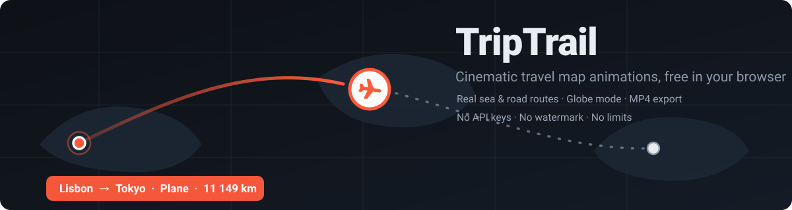

<p align="center">
  
</p>

<h1 align="center">TripTrail</h1>

<p align="center">
  Turn any trip into a cinematic animated map video — right in your browser.<br/>
  A free, no-watermark, no-API-key travel map animation studio.
</p>

<p align="center">
  <a href="https://travel-map-animator.vercel.app"><b>▶&nbsp;&nbsp;Live demo — travel-map-animator.vercel.app</b></a>
</p>

<p align="center">
  <a href="https://travel-map-animator.vercel.app"></a>
  <a href="https://developer.mozilla.org/en-US/docs/Web/JavaScript"></a>
  <a href="https://maplibre.org"></a>
  <a href="https://developer.mozilla.org/en-US/docs/Web/API/WebCodecs_API"></a>
  <a href="LICENSE"></a>
</p>

---

## 🎬 Demo

<p align="center">
  
</p>

<p align="center">
  <a href="https://github.com/Fangyuan025/triptrail/releases/download/v1.0.0/triptrail-demo-1080p60.mp4"><b>▶&nbsp;&nbsp;Watch the full demo video (original 1080p60)</b></a><br/>
  A 17-stop round-the-world trip, rendered offline at constant 60 fps by the in-browser engine itself.
</p>

## ✨ Features

|  | |
|---|---|
| 🎞️ **Rendered, not recorded** | Export steps a deterministic timeline frame-by-frame through WebCodecs (H.264 + AAC via mp4-muxer) at constant 30/60 fps — output smoothness never depends on how fast your machine renders |
| 🗺️ **Build routes 3 ways** | Search cities, click the map, or type "Lisbon to Madrid by train, then Barcelona by car" (English & 中文) |
| 🚄 **10 transport modes** | Plane, train, car, bus, boat, bike, walk, camper, motorcycle, tuk-tuk — hand-drawn vector icons; the plane banks along its smoothed heading |
| 🌊 **Real sea lanes** | Boats follow the global shipping network (Eurostat SeaRoute + Dijkstra) — through the Strait of Hormuz, not across it |
| 🛣️ **Real roads & rail corridors** | Cars/buses via OSRM; trains follow ground corridors up to 3 000 km |
| ✈️ **True great circles** | Long flights curve toward the poles and cross the antimeridian correctly — Tokyo → LA flies the Pacific |
| 🌍 **Globe & satellite** | MapLibre v5 globe projection with camera-accurate far-side occlusion; free Esri satellite imagery as the default style |
| 🎥 **Cinematic camera** | Look-ahead tracking, gentle zoom/pitch arcs mid-leg, punch-in with a pulse ripple at every arrival, overview pullback finale |
| 📝 **Notes, photos & titles** | Attach a note and a photo to any stop — the note is printed under the photo on its polaroid card, or shown as a callout beside the pin; title card and lower-third captions (CJK-aware text wrapping) |
| 🎵 **Music** | A music track is decoded, looped/faded to length and muxed as AAC |
| 💾 **Save, share & re-import** | **Export** the whole trip — stops, transport modes, notes, embedded photos and every setting — as one GeoJSON file and **Import** it later to pick up exactly where you left off. Your work also autosaves in the browser. GPX / KML / plain GeoJSON import too — try the bundled [`demo-journey.geojson`](demo-journey.geojson) |
| 🎨 **7 map styles · 4 aspect ratios** | Satellite, Voyager, Eclipse, Dark Matter, Liberty, Fiord, Positron · 16:9, 9:16, 1:1, 4:5 · custom accent color · optional watermark (off by default) |
| 🎛️ **Studio UI** | Itinerary rail with per-leg distance and transport chips, inline rename, drag to reorder, undoable clear; collapsible sidebar and mobile drawer layout |

## 🚀 Quick start

**Online:** open the [live demo](https://travel-map-animator.vercel.app), press **▶ Preview**, then **⏺ Record video**.

**Locally** — it's a static site, any server works:

```bash
git clone https://github.com/Fangyuan025/triptrail.git
cd triptrail
python3 -m http.server 8742
# open http://localhost:8742
```

## 💾 Trip files

**Export** writes a standard GeoJSON `FeatureCollection` that any GIS tool can open. TripTrail keeps its own settings in a `triptrail` member and per-stop extras in each feature's properties; **Import** reads it all back.

```jsonc
{
  "type": "FeatureCollection",
  "name": "My European Adventure",
  "triptrail": { "version": 1, "settings": { "style": "satellite", "aspect": "16:9", "accent": "#ff5a3c", "pace": 1, "title": "My European Adventure", "...": "..." } },
  "features": [
    { "type": "Feature", "geometry": { "type": "Point", "coordinates": [-9.139, 38.722] },
      "properties": { "name": "Lisbon", "note": "Pastéis de nata in Belém", "photo": "data:image/jpeg;base64,…" } },
    { "type": "Feature", "geometry": { "type": "Point", "coordinates": [-3.704, 40.417] },
      "properties": { "name": "Madrid", "mode": "train" } }
  ]
}
```

- `mode` is how you travelled **to** that stop (`plane`, `train`, `car`, `bus`, `boat`, `bike`, `walk`, `camper`, `motorcycle`, `tuktuk`).
- `note` (or a plain `description`) becomes the stop's note; `photo` is an embedded JPEG/PNG/WebP data URL.
- Everything is optional — a bare list of named points imports fine, and untrusted values are validated on the way in.

## 🧭 How it works

1. **Plan** — stops are geocoded with Nominatim; each leg picks a routing engine by transport mode: OSRM for ground, a Dijkstra search over the SeaRoute marine network for boats, great-circle interpolation for long flights.
2. **Timeline** — the whole story (camera, trail reveal, vehicle, heading, pulses, titles, photos) is a pure function of time, built as intro → approach → travel → arrival → photo / note → pullback phases. Note holds scale with the note's length so there is time to read it.
3. **Preview** — the timeline plays at wall-clock speed on the live map; the route trail is one GPU line source revealed by a `line-progress` gradient, so nothing re-tessellates per frame.
4. **Export** — the camera first sweeps the route to warm the tile cache, then the timeline is stepped frame-by-frame: each frame waits for tiles, is composited to canvas, and encoded with `VideoEncoder`; music is rendered offline and muxed as AAC. The result is a constant-fps MP4 with no watermark. (WebM or missing WebCodecs falls back to realtime capture.)

## 🙏 Free data & tools

| What | Source |
|---|---|
| Map tiles | [Esri World Imagery](https://www.arcgis.com/home/item.html?id=10df2279f9684e4a9f6a7f08febac2a9) · [OpenFreeMap](https://openfreemap.org) · [VersaTiles](https://versatiles.org) · [CARTO](https://carto.com) |
| Geocoding | [Nominatim](https://nominatim.org) (OpenStreetMap) |
| Road routing | [OSRM](https://project-osrm.org) demo server |
| Shipping lanes | [Eurostat SeaRoute](https://github.com/eurostat/searoute) marine network |
| Rendering | [MapLibre GL JS](https://maplibre.org) v5 |
| Video muxing | [mp4-muxer](https://github.com/Vanilagy/mp4-muxer) |

Map data © OpenStreetMap contributors. Satellite imagery © Esri, Maxar, Earthstar Geographics.

## 📄 License

[MIT](LICENSE) © 2026 Fangyuan Lin
